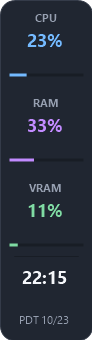
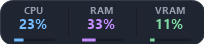
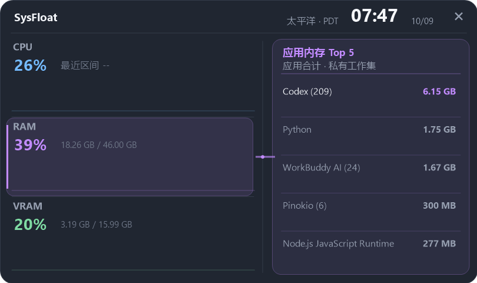
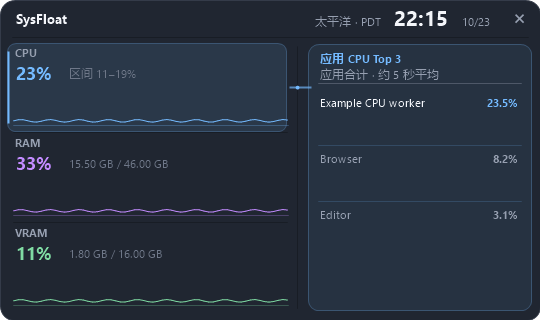
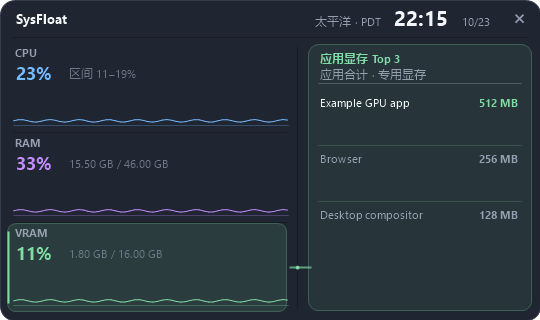
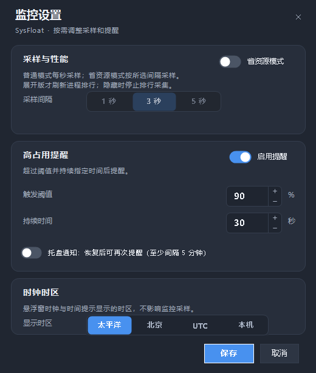
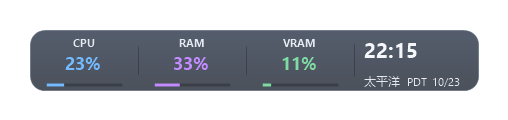
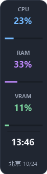
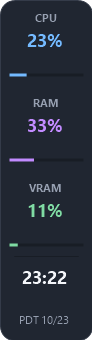

# SysFloat

一个放在桌面上的 Windows 系统资源悬浮窗，同时显示美国太平洋时间。

## 为什么做这个软件

我做 SysFloat 的初衷很简单：**方便随时查看电脑的系统资源情况。**

日常开发、运行 AI 工具或者同时打开多个应用时，我想直接看到 CPU、内存和显存的占用，不用反复打开任务管理器。SysFloat 可以放在桌面角落，按需要切换横版、竖版或展开版。

我平时也会使用 **Codex 和 Claude**，所以加了一只美国太平洋时钟，方便使用这些工具时留意美区时间、查看标注了太平洋时区的公告或安排。它是一只时间参考时钟，**不会读取账号，也不会查询或推断 Codex、Claude 的额度、计费或重置时间**。

## 下载和使用

前往 [Releases](https://github.com/knownothing20/SysFloat/releases/latest) 下载，两种附件功能完全相同：

- **`SysFloat-v1.x.x.zip`（约 45 MB，推荐）**：解压得到一个 `SysFloat` **文件夹**，整个文件夹放到任意可写位置，双击文件夹里的 `SysFloat.exe` 运行。请保持文件夹完整，不要单独把 exe 拷出去。体积说明：其中约 99% 是随包携带的 .NET 运行时（免安装、任何 64 位 Windows 直接运行），已剔除本项目用不到的 WPF 组件。
- **`SysFloat.exe`（约 146 MB）**：免解压单文件直链，放哪都能跑；体积更大是因为单文件模式无法剔除未用组件。

- 适用于 **64 位 Windows**。
- 两种附件都是 **win-x64 自包含**，不需要额外安装 .NET；文件大小不等于运行内存占用（实际运行私有内存约 40 MB）。
- 每个附件同时提供 SHA-256 校验文件。
- 程序未签名，首次运行时 Windows 可能显示安全提示；请核对下载来源和校验值。

## 功能

| 功能 | 说明 |
| --- | --- |
| 系统资源 | CPU 使用率、物理内存使用率、显存使用率 |
| 四种布局 | 横版、竖版、展开版、迷你版，可通过右键菜单切换；迷你版只占约 200×44 逻辑像素 |
| 大小调节 | Ctrl+滚轮以 5% 步进微调（50%–200%），或使用右键菜单 75/100/125/150% 预设 |
| 边缘吸附 | 拖近屏幕边缘自动贴齐，窗口始终保持在屏幕工作区内 |
| 贴边自动隐藏 | 拖到边缘停靠后可收起只留 16px 小边，鼠标移近自动滑出；顶部/底部停靠自动变横版，两侧自动变竖版，带滑动与形变动画，拖离后恢复原布局 |
| 时钟与时区 | 24 小时制、当地日期；监控设置中可选显示时区：太平洋（默认，PST/PDT 自动切换）、北京（UTC+8）、UTC、本机时区 |
| 界面语言 | 中文 / English 两种；首次运行按系统语言自动选择，可在监控设置中切换并即时生效 |
| 悬停详情 | 查看内存和显存已用/总量、CPU 最近采样区间、完整时间与时差 |
| 展开版联动排行 | 默认显示内存 Top 5；点击左侧 CPU、内存或显存，可切换对应应用合计排行，并用同色高亮关联左右两侧；进程不足 5 个时标题与行距自动适配 |
| 高占用提醒 | 设置阈值和持续时间，连续超限后对应数值与托盘图标变橙；收起在边缘时小边也会变橙 |
| 可选托盘通知 | 默认关闭；开启后最多每 5 分钟一次，通知显示也受 Windows 系统设置影响 |
| 省资源模式 | 可选 1、3、5 秒采样；普通模式每秒采样 |
| 按需刷新 | 仅展开版可见时扫描进程排行；悬浮窗隐藏或收起在边缘时停止绘图刷新 |
| 开机自启 | 默认关闭；开启后写入当前用户的注册表 Run 项 |
| 窗口选项 | 拖动、锁定位置、始终置顶、背景透明度设置，文字与指标颜色保持清晰 |

### 界面预览

**横版**


**竖版**



**迷你版**



**展开版**



<details>
<summary>查看 CPU 与显存排行联动样式</summary>





</details>

**监控设置**



布局图使用示例资源数据；应用内存图来自开发机一次真实采样。时钟为绘制时的时间，实际运行会持续更新。

### 常用操作

- 右键悬浮窗或托盘图标：切换布局、调整大小、调整透明度或打开 **监控设置…**。
- 悬浮窗上 Ctrl+滚轮：以 5% 步进缩放窗口。
- 展开版点击左侧 CPU、RAM 或 VRAM 区域：切换右侧对应应用排行；拖动仍可移动窗口。
- 点击托盘图标：显示或隐藏悬浮窗。
- 双击托盘图标：把窗口移回可见区域。
- 展开版右上角的 `×`：隐藏窗口，后台监控和提醒继续工作。
- 彻底退出：选择右键菜单中的 **退出**。

### 边缘吸附与贴边隐藏

拖动悬浮窗靠近屏幕边缘时自动贴齐。松手时如果窗口贴住边缘，即视为**停靠**：

- 开启 **贴边隐藏**（默认开启）后，停靠片刻窗口滑出屏幕，只留一条 16px 小边；鼠标移到小边上自动滑出，移开后再收回。
- 停靠方向决定形态：**顶部/底部停靠自动切换为横版，左右停靠自动切换为竖版**，切换带滑动与形变动画；拖离边缘后恢复停靠前的布局。
- 小边平时是蓝色高亮；发生高负载告警时变橙，收起状态也能看到提醒。展开停靠时内侧保留一条细线，指示"已停靠"。
- 收起状态下窗口停止每秒整帧重绘，只保留采样与告警变色，需要时再恢复。


上图展示收起后留在屏幕边缘的高亮小边（黑底为示意图）。

### 背景透明

右键菜单提供 **背景不透明 / 背景 75% / 背景 50%**。百分比表示背景的不透明度，不会把文字、数字和指标颜色一起淡化；50% 档的背景不透明度经过对比度校准，浅色桌面上数值与进度条仍可分辨。

透明模式采用按像素透明的背景和细微边缘高光，不使用实时模糊、动画或持续重绘。不透明模式保留普通绘制路径；透明绘制缓冲区按窗口尺寸复用，仅在数据或交互状态变化时更新。分隔线与进度条轨道使用随背景自适应的半透明叠印色，明暗桌面下都保持合适强度。




上图用示例背景和资源数据展示透明效果。

### 提醒与省资源模式

默认提醒阈值为 **90%**，持续时间为 **30 秒**，托盘通知默认关闭。CPU、内存、显存分别计时；不同指标交替超限不会累积成同一次持续超限。低于阈值或数据不可用时，该指标重新计时。

省资源模式需要在监控设置中打开，再选择采样间隔。更长的间隔减少采样频率，但数值更新和超限恢复判断也会相应延迟。悬浮窗隐藏后仍保留基础采样，以便托盘状态和提醒继续工作。

## 时钟时区说明

SysFloat 默认显示**美国西海岸太平洋当地时间**，方便使用 Codex、Claude 等工具时参考美区时间。如果需要其他时区，可在 **监控设置 → 时钟时区** 中切换为北京（UTC+8）、UTC 或本机时区，切换即时生效并保存：

- **太平洋**：PST（UTC−08:00）/ PDT（UTC−07:00）按 Windows 时区规则自动切换，比北京时间慢 16/15 小时。
- **北京**：固定 UTC+8，无夏令时。
- **UTC** / **本机**：分别显示协调世界时与 Windows 当前时区（按实际偏移显示 UTC±X）。

程序使用 Windows 的 `Pacific Standard Time` 等系统时区规则自动处理夏令时和跨天，不需要联网查询时间。准确度依赖电脑系统时钟和 Windows 时区规则是否正确。时区背景可参考 [NIST 说明](https://www.nist.gov/pml/time-and-frequency-division/local-time-faqs)。

<details>
<summary>查看北京时区的竖版样式</summary>



</details>

### 界面语言

界面提供 **中文 / English** 两种语言，首次运行按 Windows 系统界面语言自动选择（中文系统选中文，其余选英文）。可在 **监控设置 → 时钟与语言 → 界面语言** 中切换，保存后菜单、悬浮窗文本、进程排行、悬停提示与提醒立即切换，无需重启。

<details>
<summary>查看英文界面的竖版样式</summary>



</details>

## 数据与隐私

CPU 和物理内存通过 Windows 系统接口读取；显存通过 LibreHardwareMonitor 获取。**VRAM 表示显存使用率，不是 GPU 核心使用率**。显卡或驱动未提供相应传感器时，显示不可用，而不是猜测数值。

内存排行采用**应用分组的私有工作集**：汇总应用及其后台/子进程当前驻留在物理内存中的私有页，并显示进程数量。它不再只显示单个进程的总工作集，也不把包含共享页的工作集或私有提交量当成“内存占用”。该口径更接近任务管理器“进程”页的内存列，参见 [Microsoft 的说明](https://blogs.windows.com/msedgedev/2021/01/13/investigate-microsoft-edge-memory-usage/)。

应用分组使用进程关系、可执行文件身份及窗口归属，不为特定软件硬编码名称或数值。Windows 任务管理器的内部分组、挂起进程的处理和采样时刻仍可能与这里不同，因此不保证每一行每一刻逐字节完全一致。权限不足时不猜测数据；数值前的 `≥` 表示仅统计了可读取成员，属于已知下限。系统未提供所需内存计数时，会明确显示不可用。

CPU、内存和显存排行统一按应用归组，并显示本次参与统计的进程数量：先汇总所有可读取成员，再取应用 Top 5，避免先取单进程 Top 5 导致多进程软件被低估。不会仅凭 `node`、`python`、`rustc` 等同名进程就跨软件合并；无法可靠确认归属时保留独立条目。

CPU 排行使用各成员进程 CPU 时间在两次采样之间的增量，按系统逻辑处理器数量归一化后汇总；首次选择 CPU 时需要建立采样基线，因此会短暂显示等待采样。右侧约为 5 秒平均，左侧为系统采样区间，采样时段不同且只列 Top 5，二者不应直接相加对照。

显存排行读取 Windows 的专用 GPU 内存计数器，先按进程汇总各 GPU 的数据，再按应用归组；左侧总体显存指标则来自显卡硬件传感器。两者口径不同，跨进程共享的显存也可能被重复计入，因此不能把右侧各应用数值相加当成左侧总占用。系统或驱动不提供计数器时，会明确显示不可用，不会用普通内存替代。详情参考 [Microsoft 的 GPU 进程内存说明](https://devblogs.microsoft.com/directx/gpus-in-the-task-manager/)；[部分 Windows 版本的计数器已知问题](https://learn.microsoft.com/en-us/troubleshoot/windows-client/performance/gpu-process-memory-counters-report-wrong-value)也可能影响这些数值。

设置保存在 `%LOCALAPPDATA%\SysFloat\settings.json`。程序不需要登录，不读取 Codex、Claude 凭证，也没有新增后台联网服务。

## 从源码构建

当前源码目标框架为 `net5.0-windows`，使用 WinForms。**.NET 5 已结束官方支持**；这是现有版本的构建环境，并非建议新项目采用该版本。

仓库目录结构：

```
SysFloat.exe          直接运行的程序（不进 git，来自 Releases 或本地发布）
src\                  源码：SysFloat 主项目 + verification 验证程序
release\              本地发布输出（不进 git）
backup\               本机历史版本备份（不进 git）
local\                私有内容：内部开发记录等（不进 git，见下方隐私说明）
docs\                 公开文档与截图
tools\                publish.bat、privacy-check.ps1 等工具
```

安装匹配的 .NET SDK 后，在仓库根目录运行：

```powershell
dotnet build .\src\SysFloat\SysFloat.csproj -c Release
```

发布可直接复制运行的 x64 单文件：

```powershell
dotnet publish .\src\SysFloat\SysFloat.csproj -c Release -r win-x64 --self-contained true -p:PublishSingleFile=true -p:IncludeNativeLibrariesForSelfExtract=true -p:PublishTrimmed=false -p:UseAppHost=true -o .\release\win-x64-self-contained
```

也可以运行 `tools\publish.bat`，输出位于 `release\win-x64-self-contained\SysFloat.exe`。

### 隐私

- `local\`（内部开发记录等本机私有内容）、`release\`、`backup\` 均被 `.gitignore` 排除，不会提交或推送。
- 发布前可运行 `tools\privacy-check.ps1`（见下文）扫描仓库文本是否含个人路径、令牌等隐私内容。

### 验证

```powershell
dotnet build .\src\verification\SysFloat.Verification.csproj -c Release -p:SuppressTfmSupportBuildWarnings=true
.\src\verification\bin\Release\net5.0-windows\win-x64\SysFloat.Verification.exe
```

验证程序会短暂创建测试窗口和托盘图标，并使用独立设置文件，不会覆盖日常使用的设置。当前共 **164 项断言**，覆盖时区冬夏/跨日/重复小时与四种显示时区换算、语言自动检测与双语菜单/渲染、持续超限提醒、设置保存/取消、采样配置、显存单位、四种布局和设置窗口的 DPI 渲染、用户缩放与边缘吸附、贴边停靠/收起/弹出的状态机与留边高亮像素、开机自启注册表读写，以及真实监控与界面的接线。

验证日志和实际渲染截图保存在验证程序输出目录下的 `evidence` 文件夹。

发布前可运行隐私检查，确认仓库文本内容不含个人路径、令牌等隐私信息：

```powershell
powershell -NoProfile -ExecutionPolicy Bypass -File .\tools\privacy-check.ps1
```

## 主要依赖

- WinForms / .NET Windows Desktop Runtime
- [LibreHardwareMonitor](https://github.com/LibreHardwareMonitor/LibreHardwareMonitor)
- System.Text.Json

第三方依赖的许可证以各自项目和 NuGet 包附带的许可证为准。
